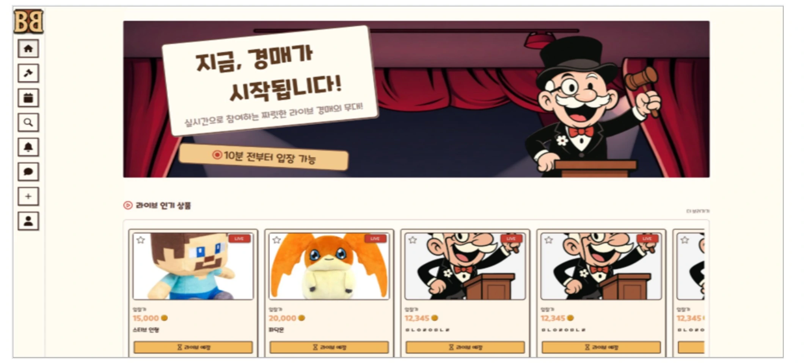
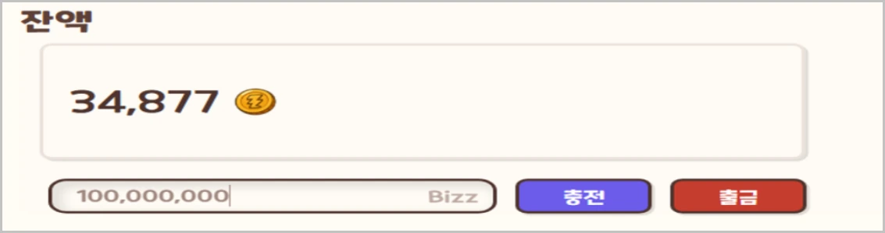
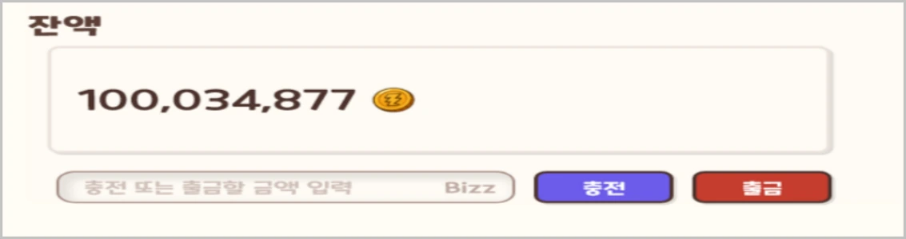
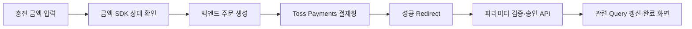
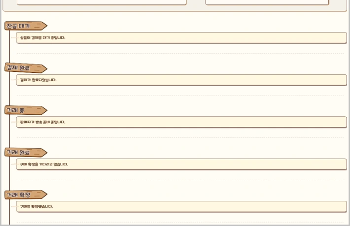
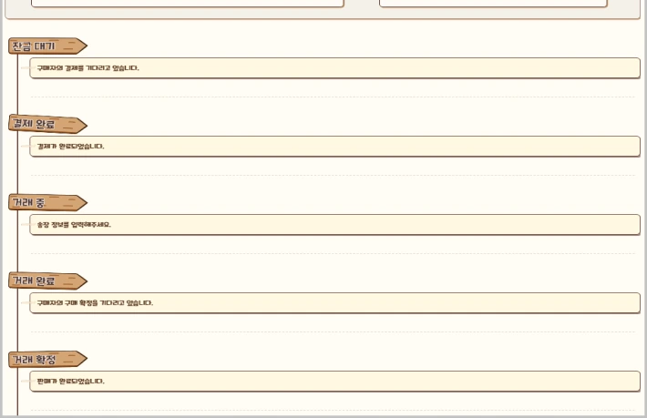
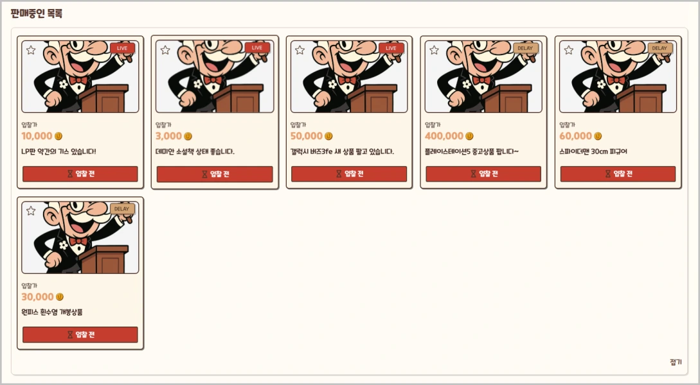
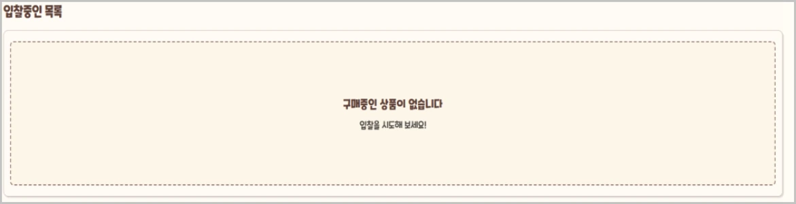
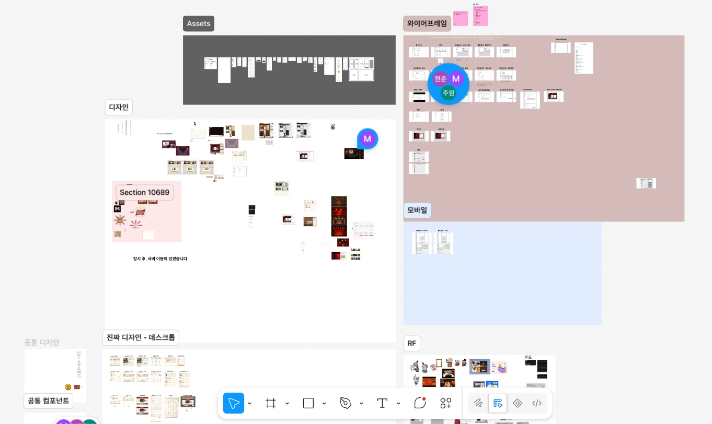

# 🛎️ BuzzerBidder

**실시간 라이브 경매와 기간형 지연 경매를 지원하는 웹 기반 경매·거래 플랫폼**

BuzzerBidder는 실시간 입찰·채팅을 활용하는 **라이브 경매**와 정해진 기간 동안 입찰하는 **지연 경매**를 제공하는 팀 프로젝트입니다. 사용자는 경매에 참여하고, 낙찰 이후 배송 정보 등록부터 구매 확정까지 거래를 관리할 수 있습니다.



> **서비스 운영 종료** · Toss Payments는 테스트 결제 환경으로 구현했으며, 실제 금전 거래는 발생하지 않습니다. 아래에서는 **팀 전체 기능**과 **개인 담당 구현**을 구분해 설명합니다.

## 📌 프로젝트 정보

| 항목      | 내용                                                                             |
| --------- | -------------------------------------------------------------------------------- |
| 개발 기간 | **2025.12 ~ 2026.03** · 팀 개발 약 5주, 이후 리팩토링 약 5주                     |
| 팀 구성   | 프론트엔드 3명, 백엔드 6명                                                       |
| 담당      | 프론트엔드 개발 · Bizz 충전/내역 조회, 거래 상세, 마이페이지, 찜                 |
| 주요 기술 | **Next.js (App Router), React, TypeScript, Tailwind CSS, TanStack Query, Axios** |
| 결제 연동 | **Toss Payments** (테스트 결제)                                                  |
| 협업      | **Git/GitHub, Figma, Slack, Zoom**                                               |

전체 서비스에는 Zustand, WebSocket/STOMP, SSE도 사용했습니다. **실시간 입찰·채팅·알림의 통신 구현은 개인 담당 성과에 포함하지 않았습니다.**

## ⭐ 주요 기능과 기여 범위

| 기능                  | 주요 내용                                              | 기여 구분     |
| --------------------- | ------------------------------------------------------ | ------------- |
| 라이브 경매           | 실시간 입찰·채팅 및 경매 진행 상황 표시                | 팀 전체 기능  |
| 지연 경매             | 기간 내 입찰 및 종료 결과 확인                         | 팀 전체 기능  |
| 실시간 알림           | 경매 관련 이벤트 알림                                  | 팀 전체 기능  |
| **Bizz 충전·내역**    | 테스트 결제 요청, 승인 연동, 현재 잔액·충전 내역 조회  | **직접 담당** |
| **거래 상세**         | 구매자 배송지 입력, 판매자 송장 등록, 구매자 구매 확정 | **직접 담당** |
| **마이페이지**        | 구매·판매·찜 목록, 빈 목록 및 더보기·접기 UI           | **직접 담당** |
| **찜**                | 찜 상태 변경 및 화면 간 캐시 동기화, 오류 발생 시 복구 | **직접 담당** |
| UI 설계·공통 컴포넌트 | Figma 시안 및 공통 UI를 프론트엔드 팀원들과 분담       | 공동 작업     |

## 🧑‍💻 담당 기능

### 1. Bizz 충전 및 결제 승인

서비스 포인트인 **Bizz의 충전 화면, 현재 잔액·내역 조회, Toss Payments 테스트 결제와 백엔드 승인 API를 연결**했습니다. 출금 자체의 기능 구현은 다른 팀원이 담당했습니다.

|                    충전 전 · 금액 입력                     |                  승인 후 · 잔액 반영                   |
| :--------------------------------------------------------: | :----------------------------------------------------: |
|  |  |



- 금액이 없거나 0 이하일 때 요청을 중단하고, SDK가 로드되지 않았을 때 안내하도록 처리했습니다.
- 성공 Redirect의 `paymentKey`, `orderId`, `amount`를 검증한 뒤 결제 승인 API를 호출합니다.
- 승인 성공 후 **사용자 정보, 결제 내역, 지갑 잔액 등** 관련 Query를 무효화해 최신 값을 다시 조회합니다.
- 결제 생성 및 승인 실패 시 오류 안내와 실패 화면 이동을 처리했습니다.

**관련 코드:** [`useTossPayment.ts`](src/features/payments/hooks/useTossPayment.ts) · [`usePaymentSearchParams.ts`](src/features/payments/hooks/usePaymentSearchParams.ts) · [`useApprovePayments.ts`](src/features/payments/hooks/useApprovePayments.ts)

### 2. 구매자·판매자별 거래 상세 UI

경매 낙찰 이후 **같은 거래라도 구매자와 판매자에게 필요한 다음 행동이 다른 점**에 집중했습니다. 역할과 거래 진행 단계를 조합해 화면에 표시할 정보, 버튼, 마일스톤 안내를 분기했습니다.

| 진행 단계      | 구매자                  | 판매자                         |
| -------------- | ----------------------- | ------------------------------ |
| 낙찰 이후      | **배송지 입력**         | 배송지 등록 대기               |
| 배송지 등록 후 | 발송 상태 확인          | 상품 발송 후 **송장번호 등록** |
| 송장 등록 후   | **구매 확정** 버튼 표시 | 구매 확정 대기                 |
| 구매 확정 후   | 구매 확정 상태 확인     | 판매 확정 상태 확인            |

|                            구매자 거래 단계                            |                            판매자 거래 단계                             |
| :--------------------------------------------------------------------: | :---------------------------------------------------------------------: |
|  |  |

개발 과정에서 어려웠던 부분은 **하나의 거래 상태 변경이 양쪽 화면에 동일한 UI 변화를 요구하지 않는다는 점**이었습니다. 예를 들어 구매자의 배송지 입력이 완료되면 판매자에게는 송장 등록 행동이 필요하지만, 구매자 화면은 배송 진행을 안내하는 형태로 남아야 합니다. 이를 위해 역할별 조건부 렌더링을 정리하고, 필요한 거래 상태와 API 응답값을 백엔드와 협의했습니다.

구매 확정 이후에는 [`tradeQueryKeys.detail(auctionType, dealId)`](src/features/trade/constants/tradeQueryKeys.ts)을 기준으로 해당 거래 상세 Query를 무효화하도록 연결했습니다.

**관련 코드:** [`useConfirmTrade.ts`](src/features/trade/hooks/useConfirmTrade.ts) · [`tradeQueryKeys.ts`](src/features/trade/constants/tradeQueryKeys.ts)

### 3. 마이페이지 및 반응형 상품 목록

구매·판매·찜 상품 목록, 상품이 없는 상태의 안내 UI, 더보기·접기 기능을 구현했습니다. 담당 화면은 Tailwind CSS를 사용해 반응형으로 구성했습니다.

|                         상품 목록                         |                    상품이 없을 때                    |
| :-------------------------------------------------------: | :--------------------------------------------------: |
|  |  |

반복되는 더보기·접기 로직은 `useExpandableProductList` Custom Hook으로 공통화했습니다.

| 화면 너비           | 접힌 상태에서 표시하는 상품 수 |
| ------------------- | -----------------------------: |
| 640px 미만          |                            2개 |
| 640px 이상 ~ 1023px |                            3개 |
| 1024px 이상         |                            5개 |

- 목록별 상품 데이터는 분리하되, **표시 개수·펼침 상태·버튼 노출 여부**는 하나의 Hook으로 관리합니다.
- 브라우저 크기 변경에 맞춰 표시 개수를 갱신하고, 이벤트 리스너 정리도 함께 처리합니다.
- 데이터가 없을 때는 별도의 빈 목록 안내를 제공합니다.

**관련 코드:** [`useExpandableProductList.ts`](src/features/mypage/hooks/useExpandableProductList.ts) · [`mypageQueryKeys.ts`](src/features/mypage/constants/mypageQueryKeys.ts)

## 🔧 문제 해결 및 리팩토링

### 1. 찜 상태 불일치 → 캐시 갱신 기준 통일

**문제:** 찜을 변경한 직후 일부 화면에는 이전 선택 상태가 남았습니다. API 응답과 새로고침 후 표시되는 데이터는 정상이라, 서버 저장보다 **화면별 캐시 반영 방식**을 우선 확인했습니다.

|                     찜 해제 상태                      |                 찜 선택 상태                  |
| :---------------------------------------------------: | :-------------------------------------------: |
|  |  |

**확인한 원인과 수정 사항**

| 확인한 지점             | 적용한 기준                                                         |
| ----------------------- | ------------------------------------------------------------------- |
| 화면마다 다른 캐시 형태 | 배열뿐 아니라 `{ items }`, `{ products, totalCount }` 형태도 갱신   |
| 상품 식별자 차이        | UI 가공용 `uid` 대신 서버 상품 **`id` + 경매 유형 `type`**으로 비교 |
| 찜 목록 데이터 불일치   | 변경 이후 마이페이지 찜 목록 Query 재조회                           |

**이후 보완: 즉시 반영과 실패 복구**

```text
찜 클릭
  ↓
onMutate: 진행 중 조회 취소 → 이전 캐시 저장 → 찜 상태 먼저 변경
  ├─ 요청 성공: 변경된 상태 유지
  └─ 요청 실패: onError에서 저장한 캐시 복구
  ↓
onSettled: 마이페이지 찜 목록 재조회
```

초기의 **화면 간 찜 상태 동기화 개선**과 이후 추가한 **Optimistic Update·Rollback**은 별개의 개선 단계입니다. 오류 응답을 유도해 이전 캐시로 돌아가는 동작도 확인했습니다.

**관련 코드:** [`useWishToggle.ts`](src/features/wish/hooks/useWishToggle.ts)

### 2. 결제 성공 화면의 책임 집중 → 단계별 분리

**문제:** 기존 결제 성공 화면에 URL 파라미터 검증, 승인 API 호출, 중복 실행 제어, 결과 UI가 모여 있어 수정 범위를 파악하기 어려웠습니다.

**개선:** 각 기능의 역할을 분리하고 성공·실패 결과 화면을 공통화했습니다.

| 코드                     | 책임                                           |
| ------------------------ | ---------------------------------------------- |
| `useTossPayment`         | 금액·SDK 상태 확인, 주문 생성과 결제창 요청    |
| `usePaymentSearchParams` | `paymentKey`, `orderId`, `amount` 파싱·검증    |
| `PaymentSuccessHandler`  | 승인 요청 연결 및 컴포넌트 내부 중복 호출 가드 |
| `useApprovePayments`     | 승인 API, 관련 Query 무효화, 결과별 라우팅     |
| `PaymentResult`          | 성공·실패 화면의 공통 UI                       |

`PaymentSuccessHandler`에서 `useRef`를 사용해 **동일한 컴포넌트 인스턴스 내 중복 승인 요청을 방지**하도록 했습니다. 이는 브라우저 재접속까지 보장하는 **서버 측 멱등성 처리와는 다른 보호 범위**입니다.

**결과:** 결제창 요청, 승인 후처리, 결과 UI의 수정 위치를 구분할 수 있도록 구조를 정리했습니다.

**관련 코드:** [`PaymentSuccessHandler.tsx`](src/components/payments/PaymentSuccessHandler.tsx) · [`usePaymentSearchParams.ts`](src/features/payments/hooks/usePaymentSearchParams.ts)

### 3. 분산된 Query Key → 도메인별 공통 정의

**문제:** 문자열 기반 Query Key가 기능별 호출부에 흩어져 있어 조회 시점의 키와 상태 변경 이후 무효화할 키를 일일이 대조해야 했습니다.

**개선:** `paymentQueryKeys`, `tradeQueryKeys`, `mypageQueryKeys` 등을 공통 정의로 분리해 조회와 무효화에 동일한 기준을 적용했습니다.

```tsx
queryClient.invalidateQueries({
  queryKey: tradeQueryKeys.detail(auctionType, dealId),
});
```

| 데이터 변경  | 확인·갱신 대상                            |
| ------------ | ----------------------------------------- |
| 결제 승인    | 사용자 정보, 지갑·결제 내역 등 관련 Query |
| 구매 확정    | 해당 거래의 상세 Query                    |
| 찜 요청 종료 | 마이페이지 찜 목록 Query                  |

또한 마이페이지 일부에서는 Server Component에서 조회한 찜 목록을 Client Component에 `initialData`로 전달해, **초기 표시와 이후 TanStack Query 조회를 연결**했습니다. 성능 향상 수치를 별도로 측정한 것은 아닙니다.

**관련 코드:** [`paymentQueryKeys.ts`](src/features/payments/constants/paymentQueryKeys.ts) · [`tradeQueryKeys.ts`](src/features/trade/constants/tradeQueryKeys.ts) · [`useMyWish.ts`](src/features/mypage/hooks/useMyWish.ts)

## 🤝 설계와 협업

| 협업 방식          | 실제 경험                                                                                                                            |
| ------------------ | ------------------------------------------------------------------------------------------------------------------------------------ |
| **공동 디자인**    | Figma 와이어프레임·화면 시안을 프론트엔드 팀원들이 필요에 따라 나누어 제작. 화면 디자인 담당과 기능 개발 담당이 반드시 같지는 않았음 |
| **코드 리뷰**      | 프론트엔드 3명이 아침에 함께 코드 변경 사항을 확인하고, 메인 브랜치 병합 전에 의견을 나눔                                            |
| **API 재협의**     | 확정 전 디자인을 바탕으로 API 개발이 먼저 진행돼, 이후 화면 요구사항에 맞게 응답 필드를 다시 협의. Zoom과 Slack으로 소통             |
| **선행 화면 개발** | 상품 카드에 표시할 정보가 많아 API 완성을 기다리는 동안 Mock 카드 데이터로 UI 구현을 진행                                            |

<details>
<summary><strong>Figma 설계 화면</strong></summary>



</details>

## 💡 회고

- **역할과 상태를 함께 고려한 UI:** 구매자·판매자의 화면은 하나의 거래 데이터를 사용하지만 필요한 행동이 달랐습니다. 화면별 조건을 정리하는 것만큼 백엔드와 상태값의 의미를 맞추는 작업이 중요했습니다.
- **여러 화면에 걸친 서버 상태 관리:** 찜 기능을 수정하면서 API 성공 여부뿐 아니라 캐시 형태와 상품 식별자, 실패 시 복구까지 함께 검토해야 함을 경험했습니다.
- **유지보수를 고려한 코드 구성:** 결제 단계별 책임 분리, Query Key 정리, 반복되는 목록 로직의 Hook 분리로 기능 변경 시 확인할 코드 범위를 명확히 했습니다.
- **협업 과정의 기준 공유:** 디자인 변경이 API 계약에도 영향을 주는 경험을 통해, 화면 요구사항과 데이터 명세를 지속적으로 맞추는 과정의 중요성을 배웠습니다.

---

**Repository:** [singilwon/BuzzerBidder](https://github.com/singilwon/BuzzerBidder) · **상태:** 서비스 운영 종료 (테스트 결제 구현)
